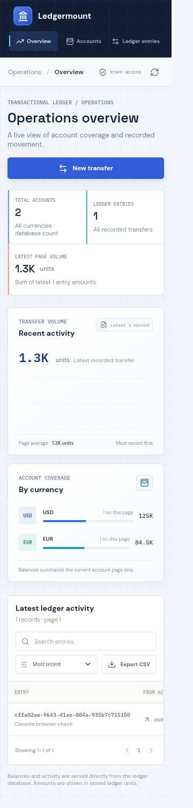
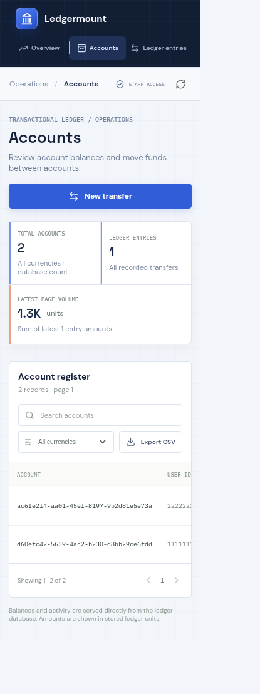
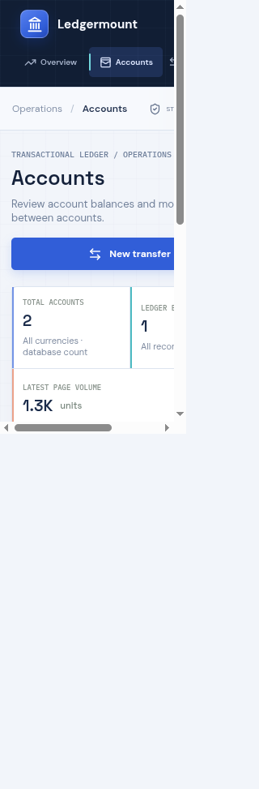
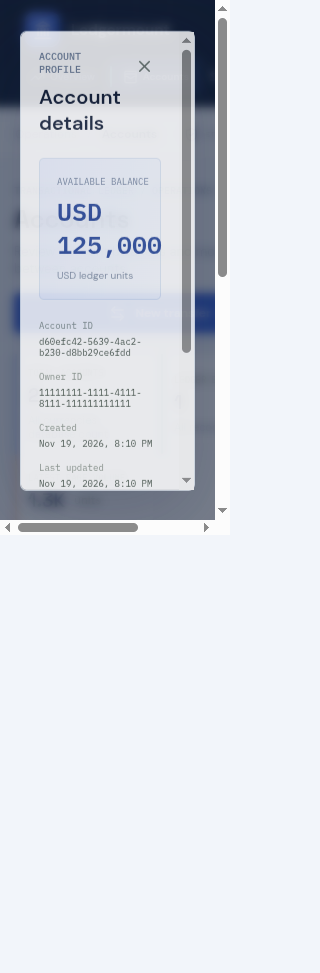
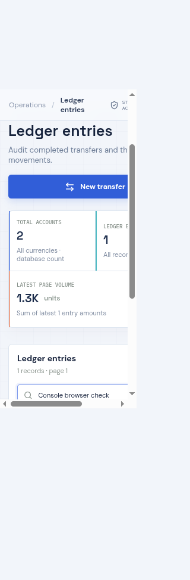
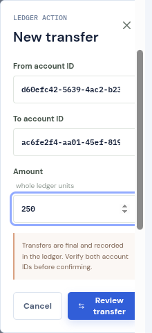
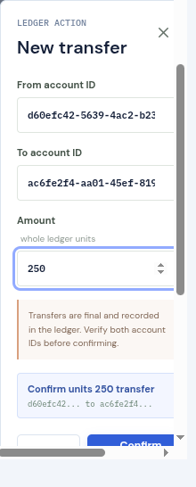
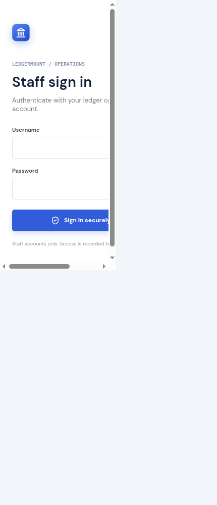
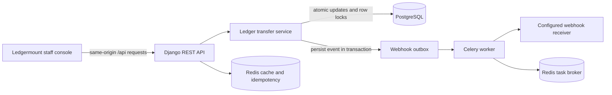

# Ledgermount

Ledgermount is the staff operations console for a transactional, double-entry ledger platform. The repository contains a Django REST API, ledger and webhook services, a React/TypeScript frontend, and local/cluster deployment examples.

> Internal operations software. Account, ledger, and transfer endpoints require a Django staff account. This project is not a customer-facing banking application and is not production-ready without the hardening described below.

## Product Screenshots

The screenshots below show the Ledgermount interface with illustrative local development data.

<table>
  <tr>
    <td><strong>1. Operations overview</strong><br></td>
    <td><strong>2. Mobile overview</strong><br></td>
  </tr>
  <tr>
    <td><strong>3. Account register</strong><br></td>
    <td><strong>4. Currency filter</strong><br></td>
  </tr>
  <tr>
    <td><strong>5. Account details</strong><br></td>
    <td><strong>6. Ledger activity</strong><br></td>
  </tr>
  <tr>
    <td><strong>7. Ledger search</strong><br></td>
    <td><strong>8. Transfer form</strong><br></td>
  </tr>
  <tr>
    <td><strong>9. Transfer review</strong><br></td>
    <td><strong>10. Staff sign-in</strong><br></td>
  </tr>
</table>

## Capabilities

- Execute integer-unit transfers between distinct accounts using a database transaction and row locks.
- Require same-currency source and destination accounts; reject invalid amounts and insufficient funds.
- Protect write requests with `X-Idempotency-Key` and Redis response caching.
- Browse and search paginated account and ledger data; filter accounts by currency and export the visible page as CSV.
- Persist transfer events to a webhook outbox and process them asynchronously with Celery.
- Require staff token authentication for operational endpoints; throttle staff sign-in attempts.
- Publish an OpenAPI schema and Prometheus metrics endpoint.

Balances and transfer amounts are stored as integers in ledger units. The API does not perform currency conversion or decimal/minor-unit formatting.

## Architecture



In local development, Django uses SQLite and an in-memory cache. Production settings use PostgreSQL and Redis. The frontend is served separately and proxies `/api/` requests to Django, avoiding a browser-side API host configuration.

## Repository Layout

| Path | Purpose |
| --- | --- |
| `frontend/` | React, TypeScript, and Vite staff console; Nginx container for deployment |
| `config/` | Django settings, URLs, ASGI/WSGI, Celery configuration |
| `src/api/v1/` | REST views, serializers, and API tests |
| `src/api/middleware/` | Redis-backed idempotency response middleware |
| `src/domains/ledger/` | Account and ledger models plus transfer service |
| `src/domains/webhooks/` | Webhook outbox model and Celery task |
| `deploy/docker/` | Django production image |
| `deploy/k8/` | Kubernetes manifests, frontend service, and migration job |
| `docker-compose.prod.yml` | Local multi-container stack example |
| `docs/screenshots/` | README product screenshots |

## Requirements

- Python 3.11 or newer
- Poetry
- Node.js 22.12 or newer and npm
- Docker Compose v2 for the container stack
- PostgreSQL and Redis for deployment; SQLite is configured for local development

## Local Development

From the repository root:

```bash
poetry install
export DJANGO_SETTINGS_MODULE=config.settings.local
poetry run python manage.py migrate
poetry run python -m django createsuperuser
poetry run python -m django runserver 127.0.0.1:8000
```

In a second terminal:

```bash
cd frontend
npm ci
npm run dev
```

Open <http://localhost:5173> and sign in with the staff account created above. Vite proxies `/api/` to `http://localhost:8000`.

Run backend tests and build the frontend with:

```bash
DJANGO_SETTINGS_MODULE=config.settings.local poetry run python -m django test
cd frontend
npm run build
```

Use `python manage.py` for standard Django commands. Ledger and webhook migrations are committed, so use `python manage.py migrate --noinput` in production and local setup.

## Docker Compose

Start the example stack from the repository root:

```bash
docker compose -f docker-compose.prod.yml up --build
```

- Ledgermount console: <http://localhost:8080>
- Django API: <http://localhost:8000>
- PostgreSQL: `localhost:5432`

Create a staff account after the API is healthy:

```bash
docker compose -f docker-compose.prod.yml exec api-gateway python -m django createsuperuser
```

The Compose file uses example credentials and exposes database/cache ports for local use. Replace these settings, use managed secrets, restrict network exposure, and configure HTTPS before any production deployment.

## Kubernetes

Build the API and frontend images, then apply database dependencies and run the migration job before rolling out the application:

```bash
docker build -t ledger-api:latest -f deploy/docker/django/Dockerfile.prod .
docker build -t ledger-console:latest -f frontend/Dockerfile frontend/
kubectl apply -f deploy/k8/postgres.yaml -f deploy/k8/redis.yaml
kubectl apply -f deploy/k8/ledger-migrate.yaml
kubectl wait --for=condition=complete job/ledger-migrate --timeout=5m
kubectl apply -k deploy/k8/
```

The console is exposed as a `ClusterIP` service on port `8080`; publish it through an ingress or use `kubectl port-forward service/ledger-console 8080:8080`. The sample manifests contain placeholder credentials and are deployment examples, not hardened production manifests. See [`deploy/k8/README.md`](deploy/k8/README.md).

## API Reference

All operational routes below require a staff token, except health and token issuance. Send tokens using `Authorization: Token <token>`. List routes return a page-number response with `count`, `next`, `previous`, and `results`; the default page size is 25.

| Method | Route | Description |
| --- | --- | --- |
| `GET` | `/api/v1/health/` | Public health probe |
| `POST` | `/api/v1/auth/token/` | Exchange staff username/password for a token; limited to 5 requests per minute |
| `POST` | `/api/v1/auth/logout/` | Revoke the current staff token |
| `GET` | `/api/v1/accounts/` | List accounts |
| `GET` | `/api/v1/accounts/<uuid:id>/` | Retrieve an account |
| `GET` | `/api/v1/ledger-entries/` | List ledger entries |
| `GET` | `/api/v1/ledger-entries/<uuid:id>/` | Retrieve a ledger entry |
| `POST` | `/api/v1/transfers` | Execute a transfer; requires `X-Idempotency-Key` |
| `GET` | `/api/schema/` | OpenAPI schema |
| `GET` | `/api/schema/swagger-ui/` | Swagger UI |
| `GET` | `/metrics` | Prometheus metrics |

### Obtain a token

```bash
curl -X POST http://localhost:8000/api/v1/auth/token/ \
  -H 'Content-Type: application/json' \
  -d '{"username":"<staff-username>","password":"<staff-password>"}'
```

The response contains a `token` string. Keep it secret and use it in the authorization header below.

### Transfer funds

```bash
curl -X POST http://localhost:8000/api/v1/transfers \
  -H 'Authorization: Token <token>' \
  -H 'Content-Type: application/json' \
  -H 'X-Idempotency-Key: <unique-request-key>' \
  -d '{"source_account_id":"<source-uuid>","destination_account_id":"<destination-uuid>","amount":100}'
```

A successful request returns HTTP `201` with a transaction ID and `AUTHORIZED` status. Amounts must be positive integers, account IDs must differ, both accounts must exist, use the same currency, and the source account must have sufficient funds.

## Configuration

Production settings read the following environment variables:

| Variable | Purpose |
| --- | --- |
| `DJANGO_SETTINGS_MODULE` | Settings module; production uses `config.settings.base` |
| `DJANGO_SECRET_KEY` | Django signing secret; provide a unique secret outside local development |
| `DB_HOST`, `DB_PORT` | PostgreSQL endpoint |
| `DB_NAME`, `DB_USER`, `DB_PASSWORD` | PostgreSQL database credentials |
| `REDIS_URL` | Django cache URL |
| `CELERY_BROKER_URL` | Celery broker URL |
| `CELERY_RESULT_BACKEND` | Optional Celery result backend |

Do not use the example database passwords or the fallback Django secret in a deployed environment. Use a secret manager and terminate TLS in a trusted ingress or reverse proxy.

## Operational Notes

- The console stores its staff token in browser `sessionStorage` and clears it on sign-out. Use HTTPS for all non-local access.
- Staff authorization currently relies on Django's `is_staff` flag. There is no customer login or per-account/tenant authorization.
- CSV export and search/filter controls operate on the currently loaded page; they do not fetch or export every record.
- Webhook delivery currently targets a hard-coded example partner URL in `src/domains/webhooks/tasks.py`. Configure the real destination and signing/verification policy before enabling external delivery.
- PostgreSQL/Redis configuration and the included Compose/Kubernetes manifests are starting points. Review credentials, TLS, backups, network policy, resource sizing, observability, and deployment rollout strategy for the target environment.

Use `python manage.py` for standard Django commands. Ledger and webhook migrations are committed and standard Django management commands are available through `python manage.py`.

## Environment Templates

Use `.env.example` for Docker/local development and `.env.vercel.example` for Vercel. Copy either template to a real ignored file before filling credentials:

```bash
cp .env.example .env
# or
cp .env.vercel.example .env.vercel
```

Fill placeholders locally; for Vercel, enter the values directly in **Project → Settings → Environment Variables**. Never commit `.env`, `.env.local`, `.env.production`, or `.env.vercel`.
