<div align="center">

# Ledgermount

**A staff operations console for a transactional, double-entry ledger platform.**


</div>

> **Internal operations software.** Account, ledger, and transfer endpoints require a Django staff account. This project is **not** a customer-facing banking application and is **not production-ready** without the hardening described in [Security and Hardening](#security-and-hardening).

---

## Table of Contents

1. [Project Overview](#project-overview)
2. [Demo Screenshots](#demo-screenshots)
3. [Features](#features)
4. [System Architecture](#system-architecture)
   - [High-Level Architecture](#high-level-architecture)
   - [Transfer Sequence](#transfer-sequence)
   - [Transfer Validation Rules](#transfer-validation-rules)
   - [Idempotency Flow](#idempotency-flow)
   - [Webhook Outbox Flow](#webhook-outbox-flow)
   - [Authentication Flow](#authentication-flow)
   - [Data Model](#data-model)
5. [Tools and Technologies](#tools-and-technologies)
6. [Repository Layout](#repository-layout)
7. [Getting Started](#getting-started)
   - [Prerequisites](#prerequisites)
   - [Local Development](#local-development)
   - [Running Tests and Builds](#running-tests-and-builds)
   - [Docker Compose](#docker-compose)
8. [Cloud Integration and Deployment](#cloud-integration-and-deployment)
   - [Deployment Topologies](#deployment-topologies)
   - [Kubernetes](#kubernetes)
   - [Reference Cloud Topology](#reference-cloud-topology)
   - [Vercel and Environment Templates](#vercel-and-environment-templates)
9. [Configuration](#configuration)
10. [API Reference](#api-reference)
11. [Observability](#observability)
12. [Security and Hardening](#security-and-hardening)
13. [Operational Notes and Known Limitations](#operational-notes-and-known-limitations)
14. [Roadmap](#roadmap)

---

## Project Overview

Ledgermount is the staff operations console for a transactional, double-entry ledger platform. It lets operations staff inspect accounts, search ledger activity, and execute transfers between accounts through a web interface backed by a documented REST API.

The repository contains:

- A **Django REST API** with ledger and webhook domain services.
- A **React / TypeScript** frontend (Vite) served by Nginx in containers.
- **Celery** workers for asynchronous webhook delivery.
- **Local and cluster deployment examples** (Docker Compose and Kubernetes).

Balances and transfer amounts are stored as **integers in ledger units**. The API does not perform currency conversion or decimal/minor-unit formatting.

---

## Demo Screenshots

The screenshots below show the Ledgermount interface with illustrative local development data.

<table>
  <tr>
    <td><strong>1. Operations overview</strong><br>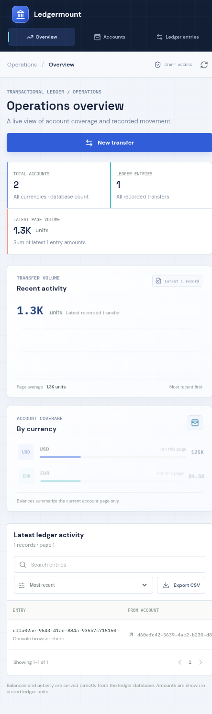</td>
    <td><strong>2. Mobile overview</strong><br></td>
  </tr>
  <tr>
    <td><strong>3. Account register</strong><br></td>
    <td><strong>4. Currency filter</strong><br></td>
  </tr>
  <tr>
    <td><strong>5. Account details</strong><br></td>
    <td><strong>6. Ledger activity</strong><br>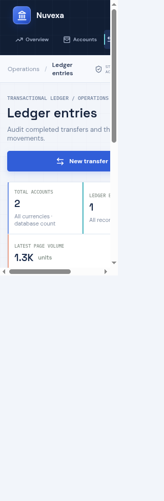</td>
  </tr>
  <tr>
    <td><strong>7. Ledger search</strong><br></td>
    <td><strong>8. Transfer form</strong><br></td>
  </tr>
  <tr>
    <td><strong>9. Transfer review</strong><br></td>
    <td><strong>10. Staff sign-in</strong><br></td>
  </tr>
</table>

---

## Features

### Ledger and transfers

- Execute **integer-unit transfers** between distinct accounts inside a database transaction with **row locks**.
- Enforce business rules: same-currency accounts, positive integer amounts, and sufficient funds.
- Return a transaction ID and an `AUTHORIZED` status on success.

### Reliability

- **Idempotent writes** via the `X-Idempotency-Key` header, backed by Redis response caching.
- **Transactional webhook outbox**: transfer events are persisted in the same transaction as the transfer, then delivered asynchronously by Celery.

### Console experience

- Browse and search **paginated** account and ledger data (default page size: 25).
- Filter accounts by currency.
- Export the currently visible page as **CSV**.
- Responsive layout, including a mobile overview.

### Security

- **Staff-only** access to operational endpoints using token authentication.
- **Throttled** staff sign-in (5 requests per minute).
- Token revocation on sign-out.

### Platform and observability

- **OpenAPI** schema with Swagger UI.
- **Prometheus** metrics endpoint.
- Public health probe for orchestration.
- Docker Compose and Kubernetes deployment examples.

---

## System Architecture

### High-Level Architecture

The browser talks only to the same origin; the frontend server proxies `/api/` requests to Django, so no browser-side API host configuration is required.

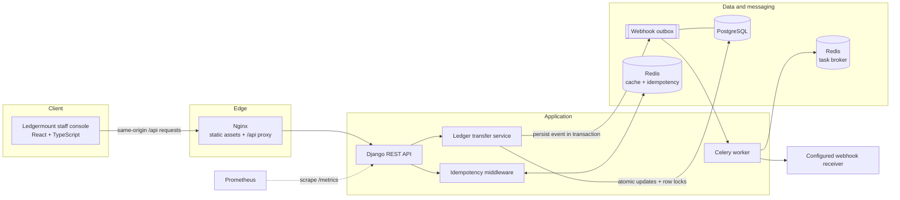

In **local development**, Django uses SQLite and an in-memory cache. **Production settings** use PostgreSQL and Redis.

### Transfer Sequence

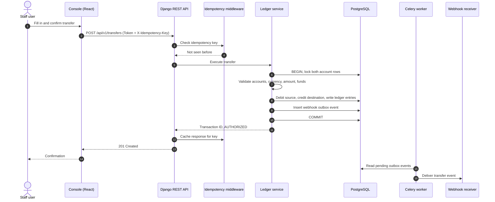

### Transfer Validation Rules

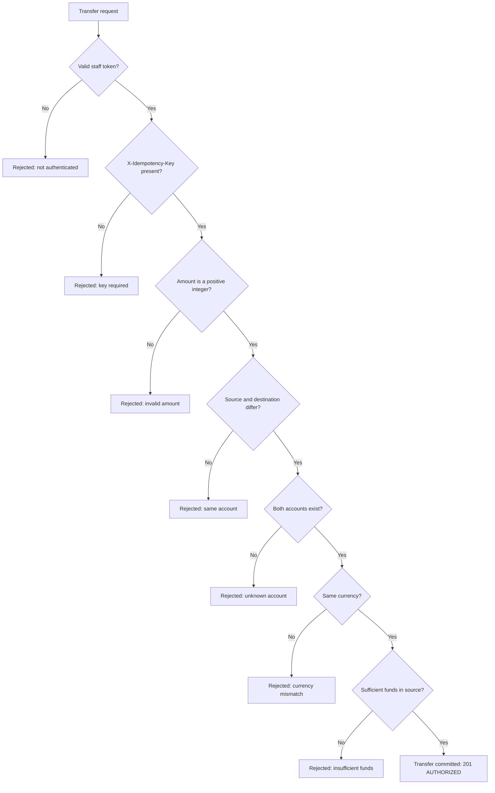

### Idempotency Flow

Write requests are protected with `X-Idempotency-Key`. A repeated request with the same key replays the cached response instead of executing the transfer again.

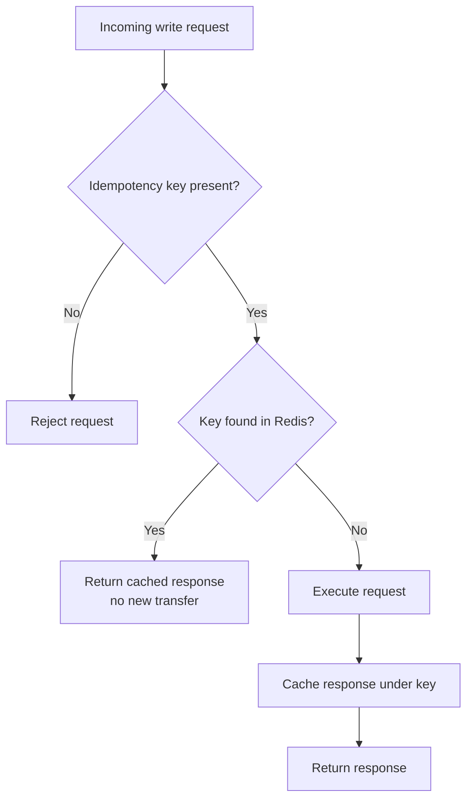

### Webhook Outbox Flow

Events are written in the **same database transaction** as the transfer, so an event exists if and only if the transfer committed. Celery delivers them asynchronously.

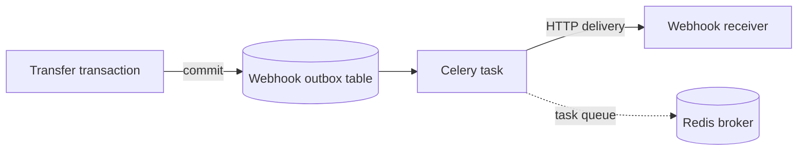

> The delivery destination is currently a hard-coded example partner URL. See [Operational Notes and Known Limitations](#operational-notes-and-known-limitations).

### Authentication Flow

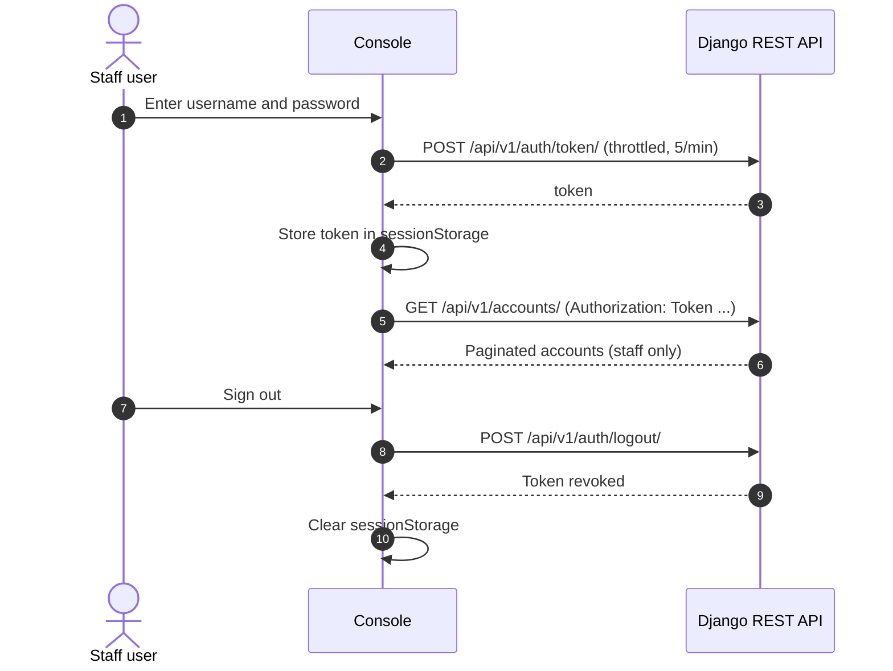

### Data Model

Simplified conceptual model. Refer to `src/domains/ledger/` and `src/domains/webhooks/` for the authoritative schema.

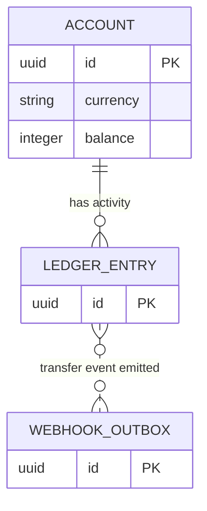

---

## Tools and Technologies

| Layer | Technology | Role |
| --- | --- | --- |
| Backend API | Django, Django REST Framework | REST endpoints, staff authentication, throttling |
| Ledger logic | Django ORM transactions with row locks | Atomic, consistent transfers |
| Async processing | Celery | Webhook outbox delivery |
| Database | PostgreSQL (production), SQLite (local) | Ledger and outbox storage |
| Cache and broker | Redis | Response caching, idempotency, Celery broker |
| Frontend | React, TypeScript, Vite | Staff console UI |
| Web server | Nginx | Serves the frontend and proxies `/api/` |
| API docs | OpenAPI, Swagger UI | Interactive API reference |
| Monitoring | Prometheus metrics | `/metrics` endpoint |
| Packaging | Poetry, npm | Python and Node dependency management |
| Containers | Docker, Docker Compose | Local multi-container stack |
| Orchestration | Kubernetes manifests (Kustomize) | Cluster deployment examples |

---

## Repository Layout

| Path | Purpose |
| --- | --- |
| `frontend/` | React, TypeScript, and Vite staff console; Nginx container for deployment |
| `config/` | Django settings, URLs, ASGI/WSGI, Celery configuration |
| `src/api/v1/` | REST views, serializers, and API tests |
| `src/api/middleware/` | Redis-backed idempotency response middleware |
| `src/domains/ledger/` | Account and ledger models plus transfer service |
| `src/domains/webhooks/` | Webhook outbox model and Celery task |
| `deploy/docker/` | Django production image |
| `deploy/k8/` | Kubernetes manifests, frontend service, and migration job |
| `docker-compose.prod.yml` | Local multi-container stack example |
| `docs/screenshots/` | README product screenshots |

---

## Getting Started

### Prerequisites

- Python 3.11 or newer
- [Poetry](https://python-poetry.org/)
- Node.js 22.12 or newer and npm
- Docker Compose v2 (for the container stack)
- PostgreSQL and Redis for deployment (SQLite is configured for local development)

### Local Development

**1. Start the backend** from the repository root:

```bash
poetry install
export DJANGO_SETTINGS_MODULE=config.settings.local
poetry run python manage.py migrate
poetry run python -m django createsuperuser
poetry run python -m django runserver 127.0.0.1:8000
```

**2. Start the frontend** in a second terminal:

```bash
cd frontend
npm ci
npm run dev
```

**3. Sign in.** Open <http://localhost:5173> and sign in with the staff account created above. Vite proxies `/api/` to `http://localhost:8000`.

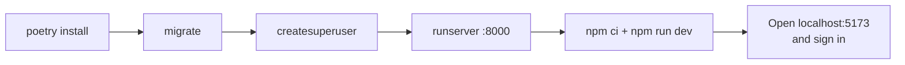

> Use `python manage.py` for standard Django commands. Ledger and webhook migrations are committed, so use `python manage.py migrate --noinput` in production and local setup.

### Running Tests and Builds

```bash
DJANGO_SETTINGS_MODULE=config.settings.local poetry run python -m django test
cd frontend
npm run build
```

### Docker Compose

Start the example stack from the repository root:

```bash
docker compose -f docker-compose.prod.yml up --build
```

| Service | URL / Address |
| --- | --- |
| Ledgermount console | <http://localhost:8080> |
| Django API | <http://localhost:8000> |
| PostgreSQL | `localhost:5432` |

Create a staff account after the API is healthy:

```bash
docker compose -f docker-compose.prod.yml exec api-gateway python -m django createsuperuser
```

> The Compose file uses **example credentials** and exposes database/cache ports for local use. Replace these settings, use managed secrets, restrict network exposure, and configure HTTPS before any production deployment.

---

## Cloud Integration and Deployment

### Deployment Topologies

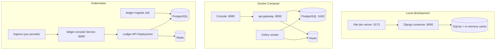

### Kubernetes

Build the API and frontend images, then apply database dependencies and run the migration job **before** rolling out the application:

```bash
docker build -t ledger-api:latest -f deploy/docker/django/Dockerfile.prod .
docker build -t ledger-console:latest -f frontend/Dockerfile frontend/
kubectl apply -f deploy/k8/postgres.yaml -f deploy/k8/redis.yaml
kubectl apply -f deploy/k8/ledger-migrate.yaml
kubectl wait --for=condition=complete job/ledger-migrate --timeout=5m
kubectl apply -k deploy/k8/
```

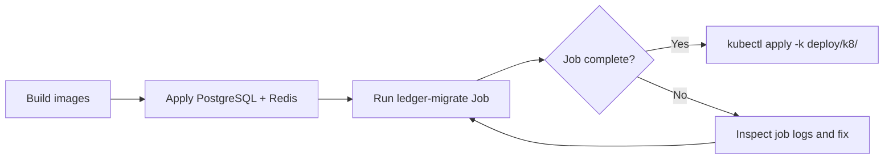

The console is exposed as a `ClusterIP` service on port `8080`. Publish it through an ingress, or for quick access use:

```bash
kubectl port-forward service/ledger-console 8080:8080
```

The sample manifests contain **placeholder credentials** and are deployment examples, not hardened production manifests. See [`deploy/k8/README.md`](deploy/k8/README.md).

### Reference Cloud Topology

The diagram below is a **recommended reference topology** for running Ledgermount on a managed cloud. It is guidance, not a shipped configuration: swap in your provider's equivalents for each component.

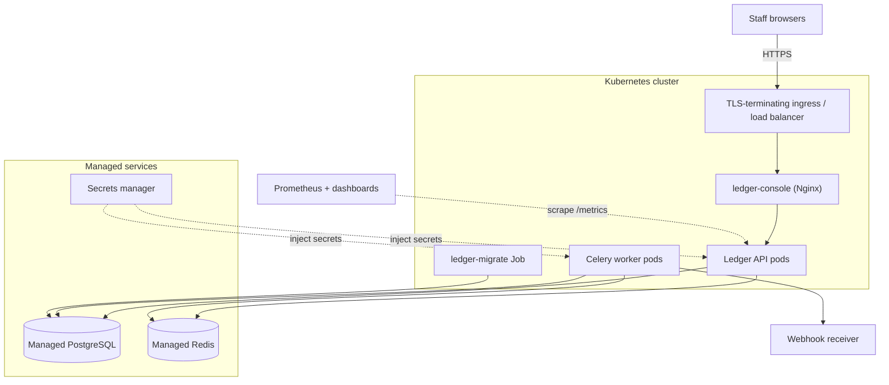

Recommendations when moving to the cloud:

- Use **managed PostgreSQL and Redis** with backups and restricted network access instead of the sample in-cluster manifests.
- Store `DJANGO_SECRET_KEY` and database credentials in a **secrets manager**, never in manifests or images.
- Terminate **TLS** at a trusted ingress or reverse proxy.
- Point health checks at `GET /api/v1/health/`.
- Scrape `GET /metrics` with Prometheus.
- Review network policy, resource sizing, and rollout strategy for your environment.

### Vercel and Environment Templates

Two environment templates are provided:

| Template | Use for |
| --- | --- |
| `.env.example` | Docker / local development |
| `.env.vercel.example` | Vercel |

Copy a template to a real, ignored file before filling in credentials:

```bash
cp .env.example .env
# or
cp .env.vercel.example .env.vercel
```

Fill placeholders locally. For Vercel, enter the values directly in **Project → Settings → Environment Variables**. **Never commit** `.env`, `.env.local`, `.env.production`, or `.env.vercel`.

---

## Configuration

Production settings read the following environment variables:

| Variable | Purpose |
| --- | --- |
| `DJANGO_SETTINGS_MODULE` | Settings module; production uses `config.settings.base` |
| `DJANGO_SECRET_KEY` | Django signing secret; provide a unique secret outside local development |
| `DB_HOST`, `DB_PORT` | PostgreSQL endpoint |
| `DB_NAME`, `DB_USER`, `DB_PASSWORD` | PostgreSQL database credentials |
| `REDIS_URL` | Django cache URL |
| `CELERY_BROKER_URL` | Celery broker URL |
| `CELERY_RESULT_BACKEND` | Optional Celery result backend |

> Do not use the example database passwords or the fallback Django secret in a deployed environment.

---

## API Reference

All operational routes require a **staff token**, except health and token issuance. Send tokens as `Authorization: Token <token>`. List routes return a page-number response with `count`, `next`, `previous`, and `results`; the default page size is 25.

| Method | Route | Description |
| --- | --- | --- |
| `GET` | `/api/v1/health/` | Public health probe |
| `POST` | `/api/v1/auth/token/` | Exchange staff username/password for a token; limited to 5 requests per minute |
| `POST` | `/api/v1/auth/logout/` | Revoke the current staff token |
| `GET` | `/api/v1/accounts/` | List accounts |
| `GET` | `/api/v1/accounts/<uuid:id>/` | Retrieve an account |
| `GET` | `/api/v1/ledger-entries/` | List ledger entries |
| `GET` | `/api/v1/ledger-entries/<uuid:id>/` | Retrieve a ledger entry |
| `POST` | `/api/v1/transfers` | Execute a transfer; requires `X-Idempotency-Key` |
| `GET` | `/api/schema/` | OpenAPI schema |
| `GET` | `/api/schema/swagger-ui/` | Swagger UI |
| `GET` | `/metrics` | Prometheus metrics |

### Obtain a token

```bash
curl -X POST http://localhost:8000/api/v1/auth/token/ \
  -H 'Content-Type: application/json' \
  -d '{"username":"<staff-username>","password":"<staff-password>"}'
```

The response contains a `token` string. Keep it secret and use it in the authorization header.

### Transfer funds

```bash
curl -X POST http://localhost:8000/api/v1/transfers \
  -H 'Authorization: Token <token>' \
  -H 'Content-Type: application/json' \
  -H 'X-Idempotency-Key: <unique-request-key>' \
  -d '{"source_account_id":"<source-uuid>","destination_account_id":"<destination-uuid>","amount":100}'
```

A successful request returns HTTP `201` with a transaction ID and `AUTHORIZED` status. Amounts must be positive integers, account IDs must differ, both accounts must exist, use the same currency, and the source account must have sufficient funds.

---

## Observability

| Signal | Endpoint | Notes |
| --- | --- | --- |
| Health | `GET /api/v1/health/` | Public probe for load balancers and orchestrators |
| Metrics | `GET /metrics` | Prometheus exposition format |
| API docs | `GET /api/schema/swagger-ui/` | Interactive OpenAPI documentation |

---

## Security and Hardening

Ledgermount is a starting point. Before any production deployment:

- [ ] Replace all example credentials in Compose and Kubernetes manifests.
- [ ] Provide a unique `DJANGO_SECRET_KEY` from a secret manager.
- [ ] Terminate **HTTPS** at a trusted ingress or reverse proxy; the console stores its staff token in browser `sessionStorage`.
- [ ] Restrict network exposure of PostgreSQL and Redis (the Compose file publishes their ports for local use).
- [ ] Configure the real webhook destination and a signing/verification policy.
- [ ] Review backups, network policy, resource sizing, observability, and rollout strategy.

Authorization currently relies on Django's `is_staff` flag. There is no customer login and no per-account or tenant authorization.

---

## Operational Notes and Known Limitations

- The console stores its staff token in browser `sessionStorage` and clears it on sign-out. Use HTTPS for all non-local access.
- CSV export and search/filter controls operate on the **currently loaded page**; they do not fetch or export every record.
- Webhook delivery currently targets a **hard-coded example partner URL** in `src/domains/webhooks/tasks.py`. Configure the real destination and signing/verification policy before enabling external delivery.
- The API does not perform currency conversion or decimal/minor-unit formatting; all amounts are integer ledger units.
- PostgreSQL/Redis configuration and the included Compose/Kubernetes manifests are starting points, not hardened production setups.

---

## Roadmap

Items below follow directly from the limitations noted above.

- [ ] Configurable webhook destination with request signing and verification
- [ ] Server-side search, filtering, and full-dataset CSV export
- [ ] Finer-grained authorization (per-account or tenant scoping)
- [ ] Hardened production manifests (network policy, resource limits, secrets integration)
- [ ] Optional decimal/minor-unit formatting in the console
